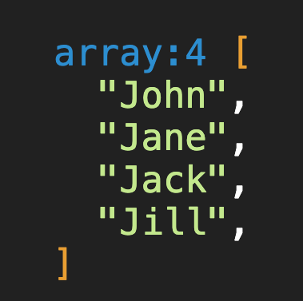
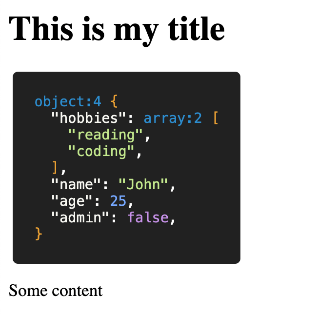
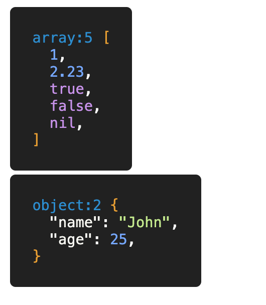

# @dump

The `@dump` directive is primarily used for debugging purposes. This directive outputs the value of variables, [objects](/language-elements/literals/object), [arrays](/language-elements/literals/array), [strings](/language-elements/literals/string) and other data types to the screen.

> [!WARNING] HTML only
> `@dump` formats its output with HTML and CSS, so it is intended for HTML templates. In JSON, XML, plain text, or other formats, the raw markup will appear in the output.

Here’s an example of how to use the `@dump` directive:

```textwire
{{ names = ["John", "Jane", "Jack", "Jill"] }}

@dump(names)
```

The output would look like something like this:



## Works with Different Types

Similarly, you can print objects and other types of data:

```textwire
<h1>This is my title</h1>

@dump({
    name: "John",
    age: 25,
    admin: false,
    hobbies: ["reading", "coding"],
})

<p>Some content</p>
```



## Dump Multiple Objects

`@dump` directive can accept any number of arguments at once:

```textwire
{{ meta = [1, 2.23, true, false, nil] }}
{{ user = { name: "John", age: 25 } }}

@dump(meta, user)
```



It's an easy and convenient way to debug your templates and see what's going on inside of them.
